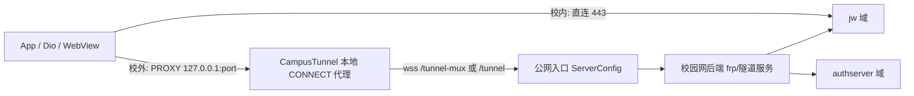
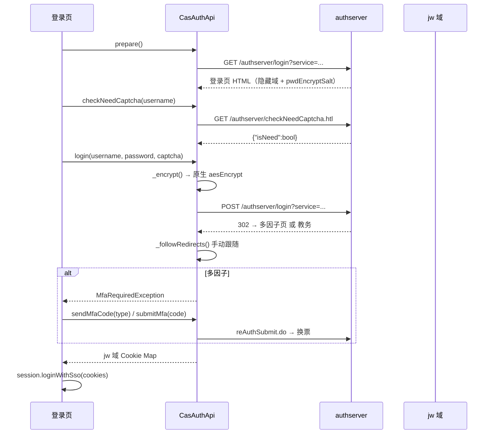

# 海畔（jw_app）项目文档

> 面向接手者与后续 AI 开发的现状说明书。所有结论均来自当前代码（`jw_app/lib`，版本 `1.0.1+4144`）。
> 文中统一用「学校」代指学校名称；域名、路径等均取自代码常量，沿用原样以便检索。
> 修改历史与逐批决策见 [`docs/modification_log.md`](modification_log.md)（最新在前，已写到 Batch85）。

---

## 1. 项目概述

### 1.1 定位

| 项 | 内容 |
|---|---|
| 应用名 | 海畔 |
| 包名 / applicationId | `cn.gdou.xiuhong` |
| 平台 | Android（Flutter） |
| 性质 | 非官方校园教务助手，个人开发 |
| 数据来源 | 学校正方教务系统 + 学校统一身份认证（authserver） |
| 联网方式 | 校内直连；校外经自建 WebSocket 隧道回到校园网 |
| 文档基线 | `pubspec.yaml` version `1.0.1+4144` |

### 1.2 功能清单（以代码实际能力为准）

| 模块 | 页面/入口 | 能力 |
|---|---|---|
| 课表 | `lib/ui/timetable/timetable_page.dart` | 周视图、学期切换、实践课、节次时间、下拉刷新、缓存秒开；通知点击直达课程 |
| 成绩 | `lib/ui/grade/grade_page.dart` | 学期切换、成绩列表、汇总/绩点、单科成绩构成明细（平时/期末/总评） |
| 考试 | `lib/ui/exam/exam_page.dart` | 学期切换、考试安排、倒计时、考试提醒 |
| 学业 | `lib/ui/academic/academic_page.dart` | 修读计划分类、修读状态（已修/在读/未修）、学分进度；入口进排名页 |
| 绩点排名 | `lib/ui/rank/rank_page.dart` | 学年学期区间、成绩性质、统计范围筛选与查询 |
| 空教室 | `lib/ui/profile/favorite_rooms_page.dart` | 校区/楼号/类别筛选，周次/星期/节次多选，常用教室收藏 |
| 通识拓展学分 | `lib/ui/profile/ge_credit_page.dart` | 按通识子类汇总已修学分，最低要求可本地调整 |
| 个人信息 | `lib/ui/profile/profile_page.dart` | 学号/姓名/院系/专业/年级/班级，退出登录 |
| 桌面小组件 | `android/.../ScheduleWidgetBase.kt` 等 | 「今日课表」「课表 + 考试」两种组件 |
| 本地提醒 | `lib/util/lesson_notifier.dart` | 上课提醒、考试提醒（原生 AlarmManager，离线可用） |
| 检查更新 | `lib/ui/profile/update_page.dart` | GitHub Release 检查、下载、安装 |
| 意见反馈 | `lib/ui/profile/feedback_page.dart` | 反馈模板 + 日志导出 |
| 设置 | `lib/ui/profile/settings_page.dart` | 主题、字号、背景、提醒、课表周起始、存储、错误修复、权限 |
| 运行日志 / 调试 | `log_page.dart`、`debug_page.dart` | 分级日志、学号脱敏、日志导出；开发者可见统计与通道调试 |
| 游客浏览 | `LoginPage` → `enterGuest()` | 未登录进入主页，仅看离线缓存 |
| APP 准入 | `appAccessProvider` | 云端白名单门控，默认禁止，管理员开通后可用 |

登录方式：**原生统一身份认证表单**（学号 + 密码，可选验证码 / 多因子）；失败时保留「使用认证网页登录」的 WebView 兜底入口。

### 1.3 技术栈与关键依赖

| 依赖 | 版本 | 用途 |
|---|---|---|
| Flutter / Dart SDK | `sdk: ^3.13.2` | 客户端框架 |
| `flutter_riverpod` | `^2.6.1` | 状态管理与依赖注入 |
| `dio` / `dio_cookie_manager` / `cookie_jar` | `^5.8.0` / `^3.2.0` / `^4.0.8` | 网络层 + 持久化 Cookie（正方纯 Cookie 鉴权） |
| `path_provider` | `^2.1.5`（override `path_provider_android: 2.2.17`） | 应用私有目录（Cookie、日志、下载） |
| `shared_preferences` | `^2.5.3` | 本地缓存、设置、指纹、会话标记 |
| `pointycastle` | `^4.0.0` | SHA-256 证书指纹（`lib/util/tls_pin.dart`） |
| `uuid` | `^4.5.1` | 历史验证码随机数（保留依赖） |
| `webview_flutter` | `^4.14.1` | 认证网页兜底登录 |
| `flutter_localizations` | SDK | 中文本地化（缺省会报 `No MaterialLocalizations found`） |
| `flutter_lints` | `^6.0.0` | 静态检查 |

> 密码 AES 加密不在 Dart 层做，而是调用原生通道 `cn.gdou.xiuhong/crypto`（`MainActivity.kt`），避免引入额外密码学依赖。

原生 MethodChannel 一览：

| 通道 | 用途 |
|---|---|
| `cn.gdou.xiuhong/crypto` | AES-CBC 加密认证密码 |
| `cn.gdou.xiuhong/auth` | Keystore EC P-256 公钥与签名 |
| `cn.gdou.xiuhong/proxy` | WebView 代理覆盖（ProxyController） |
| `cn.gdou.xiuhong/widget` | 桌面小组件刷新 |
| `cn.gdou.xiuhong/notify` | 上课/考试提醒 |
| `cn.gdou.xiuhong/nav` | 通知/组件点击跳转、小组件引导弹窗 |
| `cn.gdou.xiuhong/net` | 当前网络类型（是否仅移动数据） |

---

## 2. 目录结构

| 路径 | 职责 |
|---|---|
| `lib/main.dart` | 启动入口：`runZonedGuarded` → `_bootstrap` 立即渲染首帧 → `_warmup` 后台初始化；会话状态切换首页/登录/引导页；失效弹窗 |
| `lib/api/jw_client.dart` | `JwClient`：Dio 实例、持久化 CookieJar、会话过期探测、校外代理、wfw 通道模式、预热 |
| `lib/api/cas_auth.dart` | `CasAuthApi`：原生统一身份认证（prepare / 验证码 / AES 加密 / 登录 / 多因子 / 换票 / 注销） |
| `lib/api/jw_apis.dart` | 业务接口：`TimetableApi`、`GradeApi`、`ExamApi`、`AcademicApi`、`RankApi`、`EmptyRoomApi` 及 Provider |
| `lib/api/auth_api.dart` | `AuthApi`：教务侧登出（本地 + 服务端） |
| `lib/api/update_api.dart` | GitHub Release 检查更新；`UpdateCheckResult`、`githubRepo`、镜像前缀常量 |
| `lib/util/build_info.dart` | 从安装包原生 `appInfo` 读取 versionName / versionCode，作为唯一版本来源 |
| `lib/api/usage_api.dart` | `UsageTracker`（设备认证、会话令牌、登录上报、云端门控）、`DeviceAuth` |
| `lib/models/models.dart` | `StudentInfo`、`Timetable`、`CourseEntry`、`Grade`、`Exam`、学业/排名模型等 |
| `lib/providers/session_provider.dart` | `SessionNotifier`：会话恢复、后台握手、登录完成落盘、退出、修复；`sessionExpiredSignalProvider` |
| `lib/providers/data_providers.dart` | 数据 Provider：学期、课表、成绩、考试、学业、排名、准入、小组件同步 |
| `lib/providers/settings_provider.dart` | 设置：主题、字号、语言、背景、提醒、开学日、调试入口 |
| `lib/theme/` | `app_theme.dart`、`ink_tokens.dart`（水墨设计令牌）、`ink_page_transition.dart` |
| `lib/ui/home/` | `home_shell.dart`（5 个 tab + 准入校验 + 导入进度）、`access_denied_page.dart` |
| `lib/ui/login/` | `login_page.dart`（原生表单）、`sso_login_page.dart`（WebView 兜底 / wfw 保留代码） |
| `lib/ui/timetable|grade|exam|academic|rank/` | 各业务页面 |
| `lib/ui/profile/` | 我的、设置、更新、反馈、空教室、通识学分、日志、调试、关于、存储、通道 |
| `lib/ui/onboarding/` | 首次启动引导 |
| `lib/ui/widgets/` | 水墨组件：卡片、导航、弹窗、灵动岛通知、权限引导等 |
| `lib/util/campus_tunnel.dart` | `CampusTunnel`：本地 CONNECT 代理 → WebSocket → 校园网；多路复用 `_MuxTunnel` |
| `lib/util/webview_proxy.dart` | `WebViewProxy.set(port)`：让系统 WebView 走本地代理 |
| `lib/util/server_config.dart` | 公网入口列表、云端下发、测速选路、`TunnelEndpoint` |
| `lib/util/tls_pin.dart` | 自签证书 SHA-256 指纹固定 |
| `lib/util/local_cache.dart` | `LocalCache`：SharedPreferences 缓存 + 时间戳 + 新鲜期 |
| `lib/util/app_log.dart` | `AppLog`：分级日志、脱敏、落盘、导出 |
| `lib/util/secure_store.dart` | 令牌等敏感数据的安全存储封装 |
| `lib/util/refresh_gate.dart` | 后台自动刷新并发闸门（最多 2 个） |
| `lib/util/term_utils.dart` | `Term`/`TermUtils`：学期码、周次推算 |
| `lib/util/lesson_notifier.dart` | 上课/考试提醒排程 |
| `lib/util/home_widget.dart` | `HomeWidgetSync`：写入小组件快照并通知原生刷新 |
| `lib/util/network_info.dart` | 是否仅移动数据 |
| `lib/util/notify_target.dart` | 通知点击目标解析 |
| `lib/util/update_downloader.dart` | APK 下载（系统 DownloadManager）与安装 |
| `docs/` | `modification_log.md`（改批记录）、`ARCHITECTURE.md`、`LESSONS_LEARNED.md`、`PROJECT_SUMMARY.md`、`api-handoff/` 等 |
| `site/` | 官网源文件：`index.html`、`docs.html`、`notes.html`、`assets/` |
| `android/app/src/main/kotlin/cn/gdou/xiuhong/` | `MainActivity.kt`、小组件、通知 Receiver 等原生实现 |

---

## 3. 架构总览

### 3.1 分层

```
UI (lib/ui/*)                 ConsumerWidget / ConsumerStatefulWidget
      │ ref.watch / ref.read
      ▼
Providers (lib/providers/*)   sessionProvider / data_providers / settingsProvider
      │
      ├── API (lib/api/*)     JwClient → jw_apis / cas_auth / auth_api / update_api
      ├── Util (lib/util/*)   LocalCache / CampusTunnel / AppLog / ServerConfig
      ▼
Dio + PersistCookieJar        磁盘 Cookie（jw 域 / CAS 域 / wfw 域各自独立）
```

页面不直接 new Dio；统一通过 `jwClientProvider`（`lib/api/jw_client.dart` 末尾）取得 `JwClient`，业务 API 的 Provider 再包一层（`timetableApiProvider` 等，见 `lib/api/jw_apis.dart`）。

### 3.2 状态与数据流

| Provider | 文件 | 说明 |
|---|---|---|
| `jwClientProvider` | `lib/api/jw_client.dart` | 单例 Dio + CookieJar；注入 `onSessionExpired`、`onConnectionError` |
| `casAuthProvider` | `lib/api/cas_auth.dart` | 统一身份认证会话（独立 CookieJar `cas_cookies`） |
| `sessionProvider` | `lib/providers/session_provider.dart` | `SessionStatus{unknown, loggedIn, loggedOut}` + 学籍 + 游客/暂留标志 |
| `sessionExpiredSignalProvider` | 同上 | 每次失效自增，`main.dart` 监听后弹「立即续期」 |
| `termProvider(scope)` | `lib/providers/data_providers.dart` | 各页独立学期：`timetable` / `grade` / `exam` / `academic` |
| `timetableProvider` | 同上 | `AsyncNotifier`：缓存优先 + 后台静默刷新 |
| `gradesProvider` | 同上 | 成绩列表 + `GradeSummary` |
| `examsProvider` | 同上 | 考试列表（按时间排序） |
| `academicProvider` | 同上 | `Notifier<AsyncValue<AcademicData>>`，缓存 30 分钟 |
| `rankMetaProvider` / `rankResultProvider` | 同上 | 排名筛选项缓存 / 查询（autoDispose family） |
| `featureGatesProvider` / `appAccessProvider` | 同上 | 云端门控；准入结果按学号缓存，首次在线 6 秒超时按拒绝 |
| `homeWidgetSyncProvider` | 同上 | 课表 + 考试就绪后写快照刷新组件 |
| `enrollmentYearProvider` | 同上 | 学号前 4 位推断入学年份 |

### 3.3 缓存策略

`LocalCache` 基于 SharedPreferences，写入时同时写时间戳 `cache_ts_<key>`；`isFresh(key, ttl)` 默认 10 分钟（`kCacheFreshTtl`），学业单独放宽到 30 分钟。

| 数据 | 缓存键 | 新鲜期 | 刷新方式 |
|---|---|---|---|
| 课表 | `cache_timetable_<xnm>_<xqm>` | 10 min | 命中即返回，过期后台静默刷新 |
| 成绩 | `cache_grade_<xnm>_<xqm>` | 10 min | 同上；手动刷新顺带清 `cache_grade_detail_*` |
| 成绩分项 | `cache_grade_detail_<xnm>_<xqm>_<jxbId>` | 长期 | 首次在线，之后命中；`force` 可强制 |
| 考试 | `cache_exam_<xnm>_<xqm>` | 10 min | 同课表 |
| 学业 | `cache_academic_v2_<xnm>_<xqm>` | 30 min | 缓存先展示，过期后台拉 |
| 排名筛选项 | `cache_rank_meta_v1` | 长期 | 结果永远在线 |
| 收藏教室 | `fav_rooms_v2` | 长期 | 本地 |
| APP 准入 | `usage.app_allowed.<学号>` | 长期 | 每次启动后台复核 |

自动刷新统一经 `RefreshGate.instance.run(...)`（最多 2 并发），手动下拉/重试不经过闸门。切账号时 `LocalCache.clearData()` 清空所有 `cache_*`，避免串号。

---

## 4. 网络与登录链路（重点）

### 4.1 校内直连 vs 校外隧道



| 环节 | 代码位置 | 关键行为 |
|---|---|---|
| 网络自适应 | `CampusTunnel.adapt()`（`lib/util/campus_tunnel.dart`） | `await client.ready` → wfw 模式跳过 → 无学号不建隧道 → 已运行则复用端口 → **仅移动数据直接建通道** → 仅 Wi-Fi/有线才做直连探测 |
| 直连探测 | `_directReachable()` | `Socket.connect('jw.gdou.edu.cn', 443, 4s)`；并发调用合并为一次；只缓存「校外」结论 10 分钟（`_directTtl`） |
| 启动代理 | `ensureStarted()` / `_start()` | `ServerSocket.bind(127.0.0.1, 0)` 随机端口，重复调用返回同端口 |
| 请求接管 | `JwClient.setProxyPort(port)` | 重建 `IOHttpClientAdapter`，`findProxy = PROXY 127.0.0.1:port`；15s 连接、120s 空闲、单域 4 并发 |
| WebView 接管 | `WebViewProxy.set(port)`（`lib/util/webview_proxy.dart`） | MethodChannel `cn.gdou.xiuhong/proxy` → AndroidX `ProxyController` |
| 目标白名单 | `CampusTunnel._targets` | 仅 `jw.gdou.edu.cn` 与 `authserver.gdou.edu.cn` 的 80/443 |
| 协议解析 | `_startTunnel()` | 支持 `CONNECT host:port`（回 200 Connection Established）与明文绝对 URI（还原源站请求行） |
| 复用通道 | `_MuxTunnel` | `wss://<host>/tunnel-mux`，帧 `[type:1][streamId:4][payload]`（1 OPEN/2 DATA/3 CLOSE/4 PING），20s 心跳；失败 3 分钟内回退 |
| 单连接回退 | `_open(host, port)` | `wss://<host>/tunnel?host=&port=`，`protocols: ['haipan-v1']`，Bearer 令牌 |
| 设备令牌 | `UsageTracker.tokenFor(xh)`（`lib/api/usage_api.dart`） | 注册 → 挑战 → Keystore 签名 → 30 分钟令牌；持久化到安全存储 |
| 证书固定 | `TlsPin.shared()`（`lib/util/tls_pin.dart`） | 只认固定 SHA-256 指纹，服务端换证书须发版 |
| 预热 | `JwClient.warmUp()` | 经代理 GET `/`，30s 内不重复，提前建好 TCP+TLS+WS |
| 运行期兜底 | `JwClient` 拦截器 `onError` → `onConnectionError` | 连接错误时调用 `tunnel.adapt()` 后重试一次（`extra['tunnelRetry']` 防循环） |

登录页 `_configureNetwork()`（`lib/ui/login/login_page.dart`）会在登录前调用 `tunnel.adapt()`，并把端口同时交给 `CasAuthApi.setProxyPort()`、`JwClient.setProxyPort()`、`WebViewProxy.set()`。

### 4.2 原生统一身份认证流程

实现：`lib/api/cas_auth.dart`（`CasAuthApi`），页面：`lib/ui/login/login_page.dart`。



| 步骤 | 函数 | 说明 |
|---|---|---|
| 1. 拉认证页 | `prepare()` | GET `/authserver/login?service=https://jw.gdou.edu.cn/sso/jziotlogin`；`_parseLoginPage()` 解析 `id="pwdFromId"` 表单内隐藏域（`execution`/`lt`/`cllt`/`dllt`/`_eventId`）与 `pwdEncryptSalt` |
| 2. 已有会话 | `prepare()` 内 `_prefetched` | GET 直接跳到 jw/wfw 时，复用现有 Cookie，跳过密码提交 |
| 3. 验证码判定 | `checkNeedCaptcha(username)` | GET `/authserver/checkNeedCaptcha.htl`，返回 `isNeed`；页面缓存同号 2 分钟 |
| 4. 验证码图片 | `captchaImage()` | GET `/authserver/getCaptcha.htl`，返回 `Uint8List` 给 `Image.memory` |
| 5. 密码加密 | `_encrypt(password)` | 盐 `trim()` 后不足 16 位直接报错；MethodChannel `cn.gdou.xiuhong/crypto` 的 `aesEncrypt`（AES-CBC，64 位随机前缀 + 随机 IV，与学校 `encrypt.js` 一致） |
| 6. 提交登录 | `login()` | POST 到 `_loginUrl` 或 `/authserver/login?service=<encoded>`；表单含 `username/password/captcha/_eventId/cllt/dllt/lt/execution`；头带 `Origin`、`Referer`、浏览器 `Accept` |
| 7. 跟随跳转 | `_followRedirects()` | Dart 对 POST 302 不自动跟随，手动沿 `Location` 最多 8 跳，容忍 5xx |
| 8. 多因子识别 | `_isMfaPage()`、`_captureMfa()` | 落点含 `reAuthLoginView.do` / `reAuthParams` / 「多因子认证」即进入 MFA；解析 `reAuthUserId`、`reAuthType`（4 企业微信 / 3 短信）、`serviceUrl`；`_sendBfp()` 上报设备指纹 |
| 9. 多因子发码 | `sendMfaCode(type)` | `changeReAuthType.do`（失败忽略）+ `getDynamicCodeByReauth.do`；返回服务端提示或「已发送」 |
| 10. 多因子提交 | `submitMfa(code)` | `reAuthSubmit.do`（`followRedirects:false`，带 XHR 头）；解析 JSON 跳转候选，依次用「服务端地址 → MFA service → 登录 service」，每种再试 `authserver/login?service=` 与 service 本身 |
| 11. 取票 | `_jwCookies()` / `_cookiesAt()` | 落点 host 为 jw 或 wfw 即视为成功，从 CookieJar 读该域 Cookie（wfw 成功读 wfw 域） |
| 12. 建立会话 | `SessionNotifier.loginWithSso(cookies)` / `loginWithWfw(cookies)` | 注入 Cookie → `probeLoggedIn()` 校验 → `_completeLogin()` 落盘学籍 |
| 13. 注销 | `CasAuthApi.logout()` | GET `/authserver/logout?service=https://authserver.gdou.edu.cn`，再清本地 CAS Cookie |

补充：

- `MfaRequiredException`（同文件顶部）携带 `userId` 与 `defaultType`；`prepare()` 若发现上次多因子未完成，也会抛该异常而不是报「加密参数缺失」。
- 失败文案由 `_errorText()` 从 `showErrorTip` / `msg` / `errors` 提取，并识别「非常用账号」「锁定/冻结」。
- 隐私：密码只在内存中用于一次加密提交，不落盘；日志里学号经 `AppLog.mask()` 脱敏。

### 4.3 设备信任与账号切换

| 机制 | 实现 |
|---|---|
| CAS Cookie 持久化 | `CasAuthApi._initJar()`：`PersistCookieJar` 存 `<应用支持目录>/cas_cookies`，重启后仍是同一 CAS 设备会话 |
| 设备指纹 bfp | `_deviceFingerprint()`：首次随机 32 位 hex 写入 SharedPreferences `cas.bfp`，之后固定复用，避免被当成新设备反复要验证码/多因子 |
| 同账号保留会话 | `LoginPage._submit()`：仅当输入学号与 `savedUsername` 不同才 `cas.clearCookies()`；相同则复用已信任会话 |
| 教务 Cookie | `JwClient._init()`：`PersistCookieJar` 存 `<应用支持目录>/cookies`；`saveCookiesFor()` 给会话 Cookie 显式 30 天有效期 |
| 主动退出标记 | `jw.logged_out`：冷启动据此直接进登录页，不凭残留学号回主页；`jw.auto_sso` 控制是否允许静默续期 |

退出登录（`SessionNotifier.logout()`）：

1. `authApiProvider.logout()` → `AuthApi.logout()` GET `/logout?t=<毫秒>&login_type=` + `JwClient.clearCookies()`（真实退出地址，取自教务首页 `jwglxt_index.js`；先退出教务再退认证中心，否则教务侧判定失效后注销不生效）；
2. `casAuthProvider.logout()` → 通知统一身份认证注销 + 清 CAS Cookie；
3. `LessonNotifier.setSessionActive(false)` 取消提醒；
4. 置 `jw.auto_sso=false`、`jw.logged_out=true`，清学籍缓存，invalidate 数据 Provider，回到登录页。

### 4.4 WebView 兜底登录（`lib/ui/login/sso_login_page.dart`）

| 场景 | 行为 |
|---|---|
| 入口 | 校内：`https://jw.gdou.edu.cn/sso/jziotlogin`；隧道：`https://authserver.gdou.edu.cn/authserver/login?service=...` |
| 移动数据 | `NetworkInfo.isCellularOnly()` 为真时直接 `_enableTunnel()`，省一次失败等待 |
| 直连失败 | `onWebResourceError` → `_enableTunnel()`：先 `UsageTracker.tokenFor(xh)` 设备认证，再 `ensureStarted()` + `WebViewProxy.set()` + `JwClient.setProxyPort()` |
| 读取登录态 | `_startPoll()` 每 700ms 读 `WebViewCookieManager().getCookies(domain: jw 域)`，出现 `JSESSIONID` 即 `loginWithSso()` |
| 遮罩 | `_pageReady` / `_enteringJw` / `_StageCover`：首帧前盖住 WebView，隐藏 `ERR_TUNNEL_CONNECTION_FAILED`；回跳教务后保持遮罩直到同步完成（30s 兜底） |
| wfw 模式 | `SsoLoginPage(wfw: true)` 代码保留：入口 `https://wfw.gdou.edu.cn/xtgl/dl_loginForward.html`，成功后 `loginWithWfw()`。当前登录页只提供普通 `_openSso()`，wfw 入口默认不展示 |

---

## 5. 数据接口

### 5.1 `JwClient` 的 Dio 配置

| 项 | 值 |
|---|---|
| baseUrl | `https://jw.gdou.edu.cn` |
| 连接/接收超时 | 15s / 20s |
| followRedirects | true |
| UA | Windows Chrome/Edge 桌面 UA（避免服务端按移动端降级） |
| 数据 POST | `postData()`：`application/x-www-form-urlencoded` + `X-Requested-With: XMLHttpRequest` + `Referer` |
| HTML GET | `getHtml()`：`ResponseType.plain`，可关闭跟随重定向，302 也放行 |
| 会话过期判定 | `_detectSessionExpired()`：非登录路径响应体含 `login_slogin` → 抛 `SessionExpiredException`；302（非 login 路径）同样视为过期 |
| 登录态探针 | `probeLoggedIn()`：GET `/kbcx/xskbcx_cxXsgrkbIndex.html?gnmkdm=N2151&layout=default`；302 / 登录页 / 统一认证页均判未登录；连接超时不误判 |
| 业务失败 | `JwBusinessException`（flag != 1） |

Cookie：`PersistCookieJar(storage: FileStorage('<应用支持目录>/cookies'))`，`saveCookies()` 注入 WebView 拿到的 jw 域 Cookie。

### 5.2 业务接口

| 业务 | 方法 | 请求 | 解析 |
|---|---|---|---|
| 课表 | `TimetableApi.fetch(term)` | POST `/kbcx/xskbcx_cxXsgrkb.html`，参数 `xnm/xqm/kzlx=ck/nd` | `kbList`→`CourseEntry.fromKb`，`sjkList`→`fromSjk`，`xsxx`→`StudentInfo`；计算 `maxSection` |
| 成绩 | `GradeApi.fetch(term)` | POST `/cjcx/cjcx_cxDgXscj.html?doType=query`，`zd_fzdm=N305005-xs`，`showCount=300` | jqGrid `items`→`Grade` |
| 成绩分项 | `GradeApi.fetchDetails(grade, force:)` | POST `/cjcx/cjcx_cxCjxqGjh.html?gnmkdm=N305005`，参数 `jxb_id/xnm/xqm/xh_id/kcmc` | 先读 `cache_grade_detail_*`；否则优先 jqGrid JSON，再解析弹窗 HTML 的 `【平时】40%90` 或列式表格 |
| 考试 | `ExamApi.fetch(term)` | POST `/kwgl/kscx_cxXsksxxIndex.html?doType=query&gnmkdm=N358105`，`showCount=1000` | `items`→`Exam`，按 `kssj` 排序 |
| 学业 | `AcademicApi.fetch(xh, term)` | GET `/xsxy/xsxyqk_cxXsxyqkIndex.html?gnmkdm=N105515` 提取 30~40 位十六进制计划 id；再 POST `/xsxy/xsxyqk_cxJxzxjhxfyqKcxx.html`（方案外走 `...FKcxx.html`） | 3 路有界并发 + 每计划最多 3 次重试；按 `XDZT` 判定状态（4/有成绩=已修，1=在读，3=未修）；额外 GET `/xkcx/xkmdcx_cxXkxfhtkqkIndex.html` 取「最低修读学分 / 已获得学分」作为进度口径 |
| 绩点排名 | `RankApi.fetchPageMeta()` / `query(...)` | GET `/cjpmtj/cjpmtj_cxPjxfjdpmcxIndex.html?gnmkdm=N309106`；POST 同路径 `?doType=query` | 解析下拉/单选筛选条件；查询返回 `items`→`RankItem`，`totalCount` |
| 空教室 | `EmptyRoomApi.query(weeks, weekdays, jcds, ...)` | POST `/cdjy/cdjy_cxKxcdlb.html?doType=query&gnmkdm=N2155` | 周次/节次用位掩码 `_bitmask`；jqGrid 自动翻页（每页 100，最多 10 页，25s 预算），按 `cdbh` 去重 |
| 学籍补全 | `SessionNotifier._completeLogin()` | GET `/xsxxxgggl/xsgrxxwh_cxXsgrxx.html?gnmkdm=N100801` | 正则取 `col_jg_id`（学院）与 `col_xbm`（性别），失败不阻塞登录 |

所有接口 Provider 都在 `lib/api/jw_apis.dart` 末尾（`timetableApiProvider`、`gradeApiProvider`、`examApiProvider`、`academicApiProvider`、`rankApiProvider`、`emptyRoomApiProvider`）。

---

## 6. 关键配置

### 6.1 公网入口：`lib/util/server_config.dart`

| 项 | 值/行为 |
|---|---|
| 代码兜底入口 | `https://haipan-api.cjhong.top`（`defaultBase`） |
| 云端当前默认 | `https://120.79.176.77:59192`（深圳节点，以 `haipan.json` 的 `defaultTunnel` 为准） |
| 云端下发 | GET `<base>/tunnel/endpoints` → `{endpoints:[{name,url,default}]}`，缓存到 `server.endpoints`；当前含国内直连、Cloudflare、东莞、深圳四路 |
| 健康检查 | GET `<base>/health`，4s 连接 / 6s 读超时，状态码 <500 视为可达 |
| 隧道地址 | `wss://<host>[:port]/tunnel`（`TunnelEndpoint.wsBase`），复用通道为 `/tunnel-mux` |
| 自动选路 | `autoSelect()`：并行测速；仅当前不可达、或快 200ms 以上、或快过 1.5 倍才切换；10 分钟内不重复 |
| 手动选择 | `setActive(base, byUser: true)` 写 `server.user_choice`，优先于云端默认 |
| 证书 | 所有入口请求走 `TlsPin` 指纹校验（`lib/util/tls_pin.dart`） |
| 调试页 | 「我的 → 调试 → 公网通道」可增删入口（`lib/ui/profile/tunnel_page.dart`） |

### 6.2 更新源：`lib/api/update_api.dart`

| 常量 | 值 |
|---|---|
| `githubRepo` | `QingYu327/HaiPan` |
| 检查地址 | `https://api.github.com/repos/QingYu327/HaiPan/releases/latest` |
| `defaultGhMirror` | `https://v6.gh-proxy.org/`（下载失败回退直连） |
| 运行版本 | `BuildInfo.version` / `BuildInfo.build`（原生读取安装包，不手写常量） |
| 更新结果 | `UpdateCheckResult`：`hasUpdate` 控制首页弹窗，`isCurrent` 控制更新页置灰展示 |
| 版本比较 | 先比主版本数字段，主版本相同再比构建号；忽略 `v` 前缀与后缀（如 `-beta`） |
| 下载资产 | Release assets 中第一个 `.apk` 的 `browser_download_url` |
| 404 处理 | 仓库无 Release 时按「无更新」处理 |

门控：`featureGatesProvider` 读 `/gates` 的 `updateBlock`，命中的学号在更新页显示「已是最新」。

### 6.3 版本号规则

| 位置 | 当前值 | 规则 |
|---|---|---|
| `pubspec.yaml` `version` | `1.0.1+4144` | 正式线固定 `1.0.1`，只递增 `+` 后的构建号 |
| `lib/util/build_info.dart` | 运行时读取 | 不再维护 Dart 常量，安装包 versionName / versionCode 是唯一来源 |
| `android/gradle.properties` | `force-version-code-ignoring-abi=true` | 强制 `versionCode` = 构建号，不加 ABI 偏移（arm64 的 +2000） |

> 构建号必须大于手机上已安装包的 `versionCode`，否则 `adb install -r` 会因降级失败。

### 6.4 官网与文档

- 源文件：`site/index.html`（首页）、`site/docs.html`（使用文档）、`site/notes.html`（注意事项）、`site/assets/`（共享样式、脚本、APP 图标）。
- 部署仓库：GitHub `QingYu327/haipan-website`（`main`，Netlify 自动部署）；Gitee `heaven-does-not-move/haipan-website`（`master` 镜像）。
- 首页顶部导航在桌面显示「功能 / 网络 / 使用文档 / 注意事项」；≤860px 收起为菜单按钮，展开后仍包含文档与注意事项入口。
- 官网下载直链依赖 Release 资产名 `haipan-app-release.apk`；版本标签需与 App 当前 `1.0.1+4144` 保持同步。

---

## 7. 构建与发布

### 7.1 本地验证与构建

```powershell
cd "d:\Lime\Documents\haipan app\jw_app"
flutter analyze                                  # 应无 issue
flutter test                                     # 现有用例应全通过
.\tool\check_version.ps1                          # 检查 pubspec 版本格式
flutter build apk --release --target-platform android-arm64 --build-number=4144
```

产物：`jw_app/build/app/outputs/flutter-apk/app-release.apk`。
真机安装：`adb install -r <apk>`（模拟器需 `--target-platform android-x64`）。
签名：`jw_app/android/upload-keystore.jks`，口令在 `jw_app/android/key.properties`（已 gitignore，务必备份）。

### 7.2 版本号修改位置

1. `pubspec.yaml` 的 `version:`（改 `+` 后的构建号；如发布新正式版再改主段）；
2. 运行 `.\tool\check_version.ps1 -Tag v<版本>+<构建号>` 核对 tag 与 pubspec；
3. `docs/modification_log.md` 追加当批记录（最新在最上方）。

### 7.3 GitHub Release 上传流程

1. 用与 `pubspec.yaml` `version` 一致的 tag 创建 Release，形如 `v1.0.1+<构建号>`；
2. 上传 APK，资产名固定 `haipan-app-release.apk`（客户端取第一个 `.apk`，官网直链依赖该名称）；
3. 将 Release 标记为 latest，校验 `GET /repos/QingYu327/HaiPan/releases/latest` 的 `tag_name` 与 asset 大小/摘要。

```powershell
# 令牌只从环境变量读取，不要写进仓库或脚本
$env:GH_TOKEN = "<YOUR_GITHUB_TOKEN>"
gh release create "v1.0.1+<构建号>" "build\app\outputs\flutter-apk\app-release.apk" `
  --repo QingYu327/HaiPan --title "海畔 v1.0.1+<构建号>" --notes "<更新说明>" --latest
# 替换已有资产（同 tag 换包会破坏版本一致性，优先发新 tag）
gh release upload "v1.0.1+<构建号>" "<新APK路径>" --repo QingYu327/HaiPan --clobber
```

> 每次发版必须提升版本号并建同 tag 的 Release；客户端不内置任何 token（APK 可被反编译）。

---

## 8. 已知问题与已放弃方案

### 8.1 官方 WebVPN（wfw）通道：两段式已实测走完，仍不成立

代码中仍保留 wfw 能力（`JwClient.enableWfw()`、`CasAuthApi.useWfw()`、`loginWithWfw()`、`SsoLoginPage(wfw:true)`），但登录页**不再提供入口**。

| 证据（真机 / 模拟器 / 命令行，纯公网） | 结果 |
|---|---|
| `wfw.gdou.edu.cn/xtgl/dl_loginForward.html` 渲染统一认证页，提交账号密码 | 拿到票据，回跳 `wfw/https://jw.gdou.edu.cn/sso/jziotlogin`，返回的仍是登录页（`密码框=1`） |
| 把表单 action 改到 jw 域前缀 | 白屏 |
| 改到 authserver 域前缀 | 命令行复现 HTTP 401 |
| 教务原路径（`/xtgl/`、`/kbcx/`）经 wfw 访问 | 200，但只渲染登录页，未建立教务子会话 |
| 企业微信在同一公网环境 | 秒进教务，抓包只连 wfw、无 authserver 往返、无 jw 直连 |

**此前结论**：wfw 网关只接受「已认证的会话」，CAS 票据与教务子会话在客户端无法打通。

**Batch67 实测（命令行 Dart 脚本，真实账号 + 3 次企业微信验证码）**，完整跑通了两段式登录的**认证部分**：

1. `GET https://authserver.gdou.edu.cn/authserver/login?service=https%3A%2F%2Fwfw.gdou.edu.cn%2F` → 取盐 → POST 账号密码；
2. `302 → /authserver/reAuthCheck/reAuthLoginView.do?isMultifactor=true&service=https%3A%2F%2Fwfw.gdou.edu.cn%2F`：**该账号每次登录都强制多因子**；发出企业微信码后 `reAuthSubmit.do` 返回 `{"code":"reAuth_success"}`；
3. 第二段：`GET https://wfw.gdou.edu.cn/authserver/login?service=https%3A%2F%2Fjw.gdou.edu.cn%2Fsso%2Fjziotlogin` → 取第二套盐 → POST 账号密码 → 同样进入多因子，再发码并 `reAuth_success`。

两条关键事实（本轮新确认）：

- **认证接口必须走归一化地址** `https://wfw.gdou.edu.cn/authserver/...`。wfw 下发的 `JSESSIONID`/`route` 作用域是 `Path=/authserver`，带 `/https://authserver.gdou.edu.cn` 前缀的路径带不上 Cookie，会话每个请求都会重置（第三方仓库的 `normalizeWfwAuthUrl` 即为此）。
- 两次 `reAuth_success` 之后，`/authserver/login?service=...`（直连与 wfw 代理都一样）**仍回到多因子页**，拿不到 wfw/教务票据；`wfw/https://jw.gdou.edu.cn/...` 也只把 `Location` 改写成裸 `jw.gdou.edu.cn`（校外不可达），套回 wfw 前缀则无限 302。

**结论（Batch67 定稿）**：官方 wfw 通道在本校当前策略下**不可作为登录通道**。一次登录需要 2 次密码 + 2 次人工验证码，且票据仍不签发，比自建 NAS 隧道（1 次密码 + 1 次验证码）明显更差。NAS 隧道继续作为校外唯一通道；wfw 相关代码保留但不启用，不再投入验证。

### 8.2 海大课表（同类项目）实现要点

- 技术栈：Expo / React Native，数据用 AsyncStorage 保存，无第三方后端；`src/constants/gdouEndpoints.ts` 集中维护所有 URL。
- 校外：`netcheck.gdou.edu.cn/go.php?code=jw` 探测是否被重定向到 `wfw`；校外时按 8.1 的“两次登录”建立 wfw 教务会话，校内则直连 jw。
- 登录：HTML 隐藏域取 `pwdEncryptSalt/execution/lt`，密码按 Wisedu `encryptPassword` 实现（AES-128-CBC + PKCS7，明文为 64 位随机串+密码，Base64），缺盐直接报错不降级明文；验证码 `checkNeedCaptcha.htl` + `getCaptcha.htl`；多因子走 `changeReAuthType.do`/`getDynamicCodeByReauth.do`/`reAuthSubmit.do`。
- 数据：课表 `POST /kbcx/xskbcx_cxXsgrkb.html`、考试 `kwgl/kscx_cxXsksxx.html?doType=query`、成绩 `cjcx/cjcx_cxXsgrcj.html?doType=query`，另有 `/jwglxt` 前缀兼容与学期下拉解析。
- 提醒：不依赖自家进程存活，批量写**系统时钟闹钟**（Android `AlarmClock.ACTION_SET_ALARM`，iOS 26+ AlarmKit），由系统时钟保证后台触发；这正是国产 ROM 杀后台场景下比自建 AlarmManager 更稳的思路。

### 8.3 WebView 页面退出偶发报错（已修，Batch64）

- 原现象：从 `SsoLoginPage`（WebView 页面）返回时偶发 Flutter 框架级报错，涉及 `GlobalKey` 与 `TextEditingController`。
- 根因：校外补填学号的 `showDialog` 在 `await showDialog` 返回后立刻 `dispose()` 控制器，而对话框还有约 120ms 退场动画，退场中的 `TextField` 继续使用已释放控制器；该异常在路由 teardown 阶段会连带触发重复 GlobalKey 断言。
- 修复：输入框改为独立 `_XhDialog` StatefulWidget，由自身 `dispose` 释放控制器；`SsoLoginPage` 增加 `_disposed` 标记，WebView 回调、轮询与定时器在页面销毁后立即退出。
- 验证：debug 包在真机反复「进入认证网页 → 返回」及「弹出学号框 → 连续返回」均无 Flutter 异常；`flutter analyze` 无问题、`flutter test` 全通过。

### 8.4 其他已知限制

| 问题 | 说明 |
|---|---|
| 校外→校内切换延迟 | 「校外」探测结论缓存 10 分钟，切回校园网后最多 10 分钟仍走隧道（功能不受影响） |
| 公网延迟 | 每条 TCP 流经隧道，RTT 常 >1s；已用「移动数据跳过 4s 直连探测」+ 复用通道 + 预热 + 连接池 4 并发 + `RefreshGate` 缓解 |
| 提醒后台不触发 | 依赖精确闹钟权限与 ROM 自启动/电池白名单；已声明 `USE_EXACT_ALARM`（Android 13+ 自动授予），无权限时才降级为非精确闹钟 |
| 学业多请求 | 计划数多时耗时最长，自动刷新窗口放宽到 30 分钟 |
| 更新黑名单 | 命中后更新页显示无更新，不阻断启动 |
| APP 准入 | 首次无缓存且在线校验失败时按拒绝处理（`AccessDeniedPage`） |

---

## 9. 开发约定

### 9.1 日志规范：`lib/util/app_log.dart`

| API | 级别 | 用途 |
|---|---|---|
| `AppLog.d(tag, msg)` | D | 细节/耗时；`debugDetail=false` 时不输出 |
| `AppLog.w(tag, msg)` | W | 可恢复异常、降级、被忽略的失败 |
| `AppLog.e(tag, msg)` | E | 真实失败、异常栈 |

- 统一格式：`ISO8601 [级别] [模块] 正文`，内存保留最新 800 条，写入 `<应用支持目录>/app.log`，默认保留 7 天（`setRetention` 可调）。
- **任何写入前自动脱敏**：`AppLog.mask()` 把 6~20 位连续数字保留前 2 后 2，其余替换 `*`（学号不明文落盘/外发）。
- `init()` 中挂接 `FlutterError.onError` 与 `PlatformDispatcher.onError`，异常会以 `[Flutter]` / `[Platform]` 记录。
- 入口日志：`main.dart` 的 `_warmup()` 记录「基础初始化 xxms」；登录页记录「网络通道就绪 / 通道+认证页就绪 / 密码校验 / 总耗时」；隧道记录建连、复用、回退、预热耗时。
- 常用 tag：`启动`、`登录`、`会话`、`通道`、`网络`、`缓存`、`课表`、`成绩`、`考试`、`学业`、`认证`、`风控`、`准入`、`统计`、`提醒诊断`、`Flutter`、`Platform`。

### 9.2 代码风格

- 注释、日志、错误文案统一中文；注释解释「为什么这么做」，而不复述代码；
- 页面不直接持有 Dio，统一走 Provider；
- 网络失败必须区分「网络错误」与「业务/鉴权错误」，前者可重试，后者直接给可读文案；
- 新增业务接口时：在 `lib/api/jw_apis.dart` 建 Api 类 + Provider，在 `data_providers.dart` 建缓存优先 Provider，页面只 watch；
- 修改后必须 `flutter analyze` 通过。

### 9.3 修改记录（Batch）

- 位置：`docs/modification_log.md`，**最新在最上方**；
- 每条包含：日期 + Batch 号 + 主题（构建号）→ 范围与文件 → 关键决策与原因 → 验证（analyze/test/构建号/真机）→ 部署 → 遗留问题；
- 涉及原生、后端、部署的改动也要在同一批注明。

---

## 10. 接手建议

### 10.1 建议阅读顺序

1. `docs/PROJECT.md`（本文）→ `docs/modification_log.md` 最近 5 个 Batch；
2. `lib/main.dart` → `lib/providers/session_provider.dart`（会话生命周期）；
3. `lib/api/jw_client.dart` → `lib/util/campus_tunnel.dart`（网络与隧道）；
4. `lib/api/cas_auth.dart` → `lib/ui/login/login_page.dart`（登录链路）；
5. `lib/api/jw_apis.dart` → `lib/providers/data_providers.dart`（业务数据与缓存）；
6. `lib/util/app_log.dart`、`lib/util/server_config.dart`、`lib/util/local_cache.dart`；
7. `docs/ARCHITECTURE.md`、`docs/LESSONS_LEARNED.md`、`docs/api-handoff/`（接口契约与抓包校准）。

### 10.2 验证清单

| 场景 | 步骤 | 通过标准 |
|---|---|---|
| 编译 | `flutter analyze` | No issues |
| 校内直连登录 | 校园网下用真实账号登录 | 无验证码或按提示输入；进入主页；日志有「密码校验 xxms」 |
| 校外隧道登录 | 关闭 Wi-Fi 用移动数据，清会话后登录 | 日志有「校外环境，已自动启用通道」；认证页与教务可访问 |
| 多因子 | 触发 MFA 的账号 | 可选企业微信/短信，手动获取验证码后登录成功 |
| 课表同步 | 登录后进课表 | 显示本学期课程、周次、节次时间；重启后缓存秒开 |
| 成绩/考试/学业 | 各页切换学期 | 有数据、可下拉刷新；断网时回退缓存 |
| 桌面小组件 | 添加「今日课表」「课表 + 考试」 | 显示今日课程与考试倒计时，App 内刷新后同步 |
| 提醒 | 设置提前分钟数，等待触发 | 通知准时，点击可跳转对应课程/考试 |
| 退出登录 | 我的 → 退出登录 | 返回登录页；重启不自动进主页；无旧账号提醒残留 |
| 更新 | 我的 → 检查更新 | 能拉到 Release 更新日志；下载安装可完成 |
